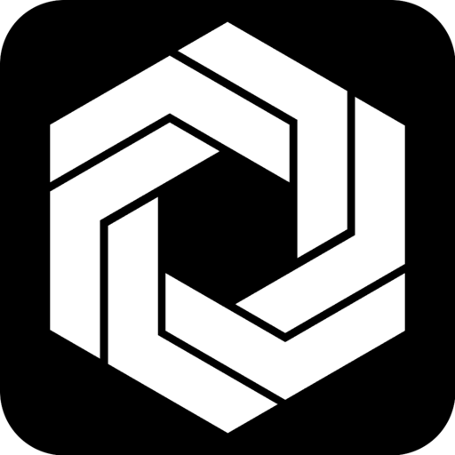

  

<h3 align="center">Kijk</h3>

---

 Meet <strong>Kijk</strong>: the open-source app that helps you understand and plan what you use – any resource you measure, such as electricity, water or fuel, with limits, and your money with budgets – privately for yourself and together in shared spaces with your household, flatmates or partner.
 

> This Project is still under development

## 📝 Table of Contents

- [Motivation](#motivation)
- [Getting Started](#getting_started)
- [Developer Guide](#developer-guide)
- [Deployment](#deployment)
- [Built Using](#built_using)
- [Contributing](../CONTRIBUTING.md)
- [License](#license)
- [Acknowledgments](#acknowledgement)

## 🧐 Motivation 

At the core of Kijk is my motivation to explore new technologies while crafting an app that caters to every user, including myself. I embarked on this journey to create an app that makes it easy to understand and plan the resources and money a home uses, driven by my own need for such a tool.
I invite you, as new users, to join this project. Let's collaborate on this open-source project, combining our skills to make Kijk an even more valuable tool for planning resources and budgets. Your participation and contributions will not only enhance the app's features but also ensure that it addresses a wider array of needs and preferences. Together, we can shape a tool that empowers us all to manage our homes efficiently and effortlessly.

Feel free to explore the codebase to get inspiration or help with this project 🫶

## 🏁 Getting Started 

If you want to use the live production app go to this [link](https://kijk-app.justmax.xyz/) and feel free to leave some feedback on our [discussion board](https://github.com/maxstue/kijk/discussions).
And if you are a developer and want to contribute to this project please go [here](#developer-guide) for more information.

## 🖥️ Developer Guide 

Please refer to the contributing [guide](./.github/CONTRIBUTING.md) for how to install Kijk from sources.

## 🚀 Deployment 

Deployment is handled through the repository's GitHub Actions workflows.

The single [web application](./apps/client/README.md) uses TanStack Start and a Nitro Node server on Railway. It serves both the public website and the client-rendered signed-in application, with a same-origin BFF to the .NET API.

## ⛏️ Built Using 

- [React](https://react.dev/) - Frontend Library
- [TanStack Start](https://tanstack.com/start) - Web framework and BFF
- [Vite+](https://viteplus.dev/) - Frontend toolchain
- [Tailwind](https://tailwindcss.com/) - Styling
- [dotnet](https://dotnet.microsoft.com/en-us/) - Server Framework
- [PostgreSQL](https://www.postgresql.org/) - Database

## License

Kijk is licensed under [AGPL-3.0-only with additional attribution and origin
terms](./LICENSE). Forks and commercial hosting are welcome: preserve
the reference to Kijk and its original author, identify your changes, and
follow the AGPL source-sharing requirements, including for modified
versions used over a network. The full license and required attribution
are in [LICENSE](./LICENSE).

## 🎉 Acknowledgements 

- [shadcn/ui](https://github.com/shadcn-ui/ui)
- [The Documentation Compendium](https://github.com/kylelobo/The-Documentation-Compendium)
- openAi for helping with writing texts 🤖
